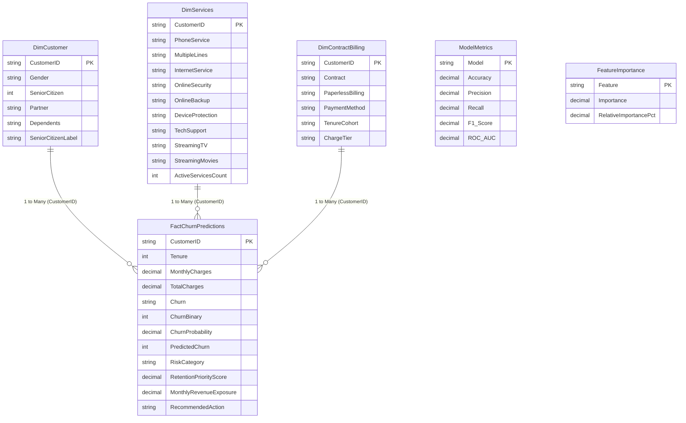

# Power BI Star-Schema Data Model Specification

## 1. Schema Architecture Overview
The semantic data model utilizes a high-performance **Star Schema** architecture optimized for fast analytical aggregations, clean DAX expressions, and clear relationship semantics.

---

## 2. Table Relationships & Cardinality

| From Table (Dimension) | From Column | To Table (Fact) | To Column | Cardinality | Cross Filter Direction |
| :--- | :--- | :--- | :--- | :--- | :--- |
| `DimCustomer` | `CustomerID` | `FactChurnPredictions` | `CustomerID` | 1 to 1 (or 1 to Many) | Single (`DimCustomer` filters `Fact`) |
| `DimServices` | `CustomerID` | `FactChurnPredictions` | `CustomerID` | 1 to 1 (or 1 to Many) | Single (`DimServices` filters `Fact`) |
| `DimContractBilling` | `CustomerID` | `FactChurnPredictions` | `CustomerID` | 1 to 1 (or 1 to Many) | Single (`DimBilling` filters `Fact`) |
| `ModelMetrics` | Standalone | *Metadata Table* | N/A | None | Disconnected (Used for ML KPI cards) |
| `FeatureImportance` | Standalone | *Metadata Table* | N/A | None | Disconnected (Used for Feature Chart) |

---

## 3. Storage Mode & Engine Performance
- **Storage Mode**: Dual / Import (In-Memory VertiPaq Engine).
- **Index Optimization**: Surrogate / Primary keys mapped on `CustomerID`.
- **Memory Footprint**: Highly compressed columnar format (< 3 MB footprint).
